<p align="center">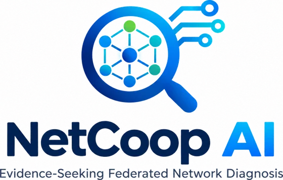</p>

<p align="center">
<b>Interoperable multi-agent network fault diagnosis</b> for the <i>Agentic AI Grand Finale, IIT Bhubaneswar</i> challenge<br>
<a href="https://github.com/RajRai77/netcoop-ai/actions/workflows/ci.yml"></a>
</p>

Three **independent specialist agents** (Performance, Infrastructure, Connectivity & Services) run as separate processes,
analyse validated telemetry and exchange typed **NDEP** findings over the **A2A protocol**. A deterministic reasoner
(**STEaR**) compares competing root-cause hypotheses against the topology and the timeline. When the leading
explanations cannot be told apart, it **asks the agent that owns the missing evidence for one discriminating
observation**, then reports a diagnosis with traceable evidence and a calibrated confidence, or honestly abstains.
No LLM is required, and none is used.

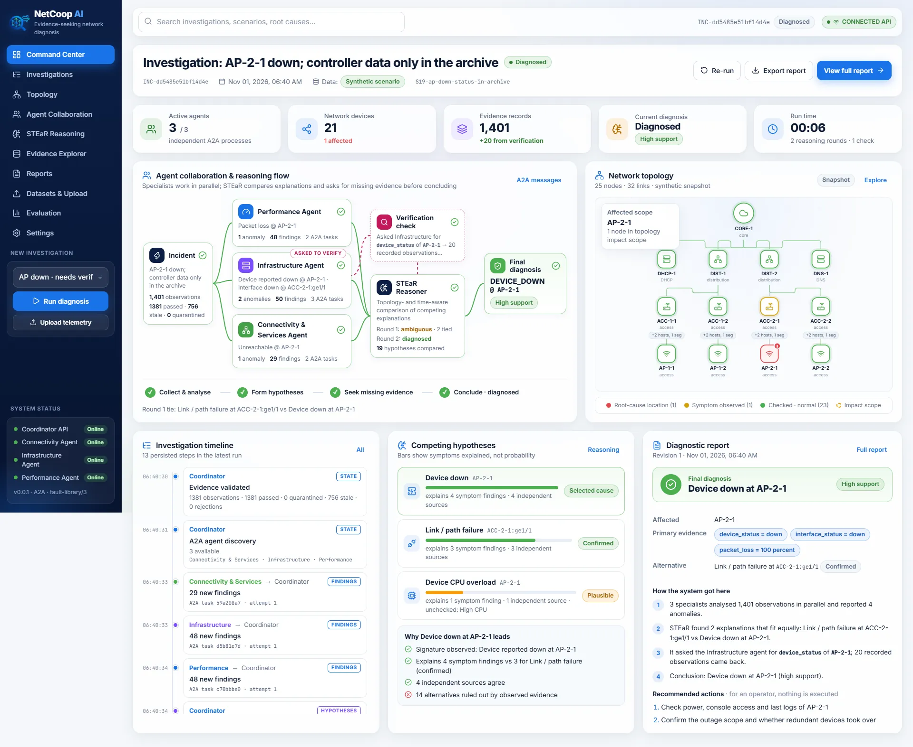

> All bundled data is **synthetic** and labeled as such (including the organizer's sample-generator data). No live campus
> network is accessed. Recommended actions are for a human operator and are never executed.
> Current verified state: [docs/14_PROJECT_PROGRESS.md](docs/14_PROJECT_PROGRESS.md).

## Contents

[Run it](#run-it) · [What you will see](#what-you-will-see) · [Architecture](#architecture) · [A2A workflow](#a2a-workflow-real-s19-run) ·
[Problem-statement coverage](#problem-statement-coverage) · [Report & confidence](#report-and-calibrated-confidence) ·
[Organizer data](#organizer-data-ps-section-5-sample-generator) · [Evaluation](#evaluation-honest-numbers) · [Testing](#testing-evidence) ·
[Deployment](#deployment) · [Limitations](#honest-limitations) · [Repository map](#repository-map)

## Run it

**One command** (Windows, Linux or macOS). Needs [uv](https://docs.astral.sh/uv/getting-started/installation/); uv fetches
Python 3.12 if it is missing. No Docker, cloud account or API key.

```sh
git clone https://github.com/RajRai77/netcoop-ai.git && cd netcoop-ai
./start.sh                                             # Windows: powershell -ExecutionPolicy Bypass -File start.ps1
```

Open **http://127.0.0.1:8000/**. One launcher starts **four OS processes**: the API/coordinator (which also serves the
React app) and three specialist A2A servers on free loopback ports with a fresh per-run token. It applies database
migrations (SQLite in `./var`), waits for every health check and stops everything on Ctrl+C. From a git clone the React
app is built once if Node.js is installed; the **release ZIP already contains it**, so Node is not needed there.

```sh
uv run python scripts/run_local.py --check        # start, run a real A2A diagnosis, verify, stop (exit 0/1)
uv run python scripts/run_local.py --port auto    # if 8000 is busy
uv run pytest                                     # test suite (PostgreSQL variants need NETCOOP_TEST_DATABASE_URL)
```

In the app: **Run diagnosis** in the sidebar (organizer data is preselected), or **Datasets & Upload** to upload NDEP JSON,
vendor CSV via a declared profile, or the organizer generator's JSON. The **verification showcase** is scenario
`S19-ap-down-status-in-archive`.

## What you will see

| | |
|---|---|
| 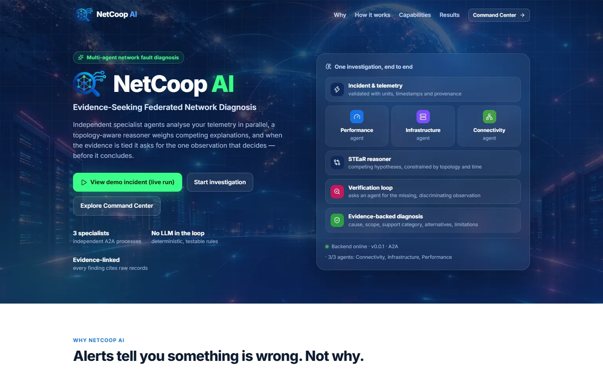 **Landing:** what the system does, how one investigation flows, live backend status | 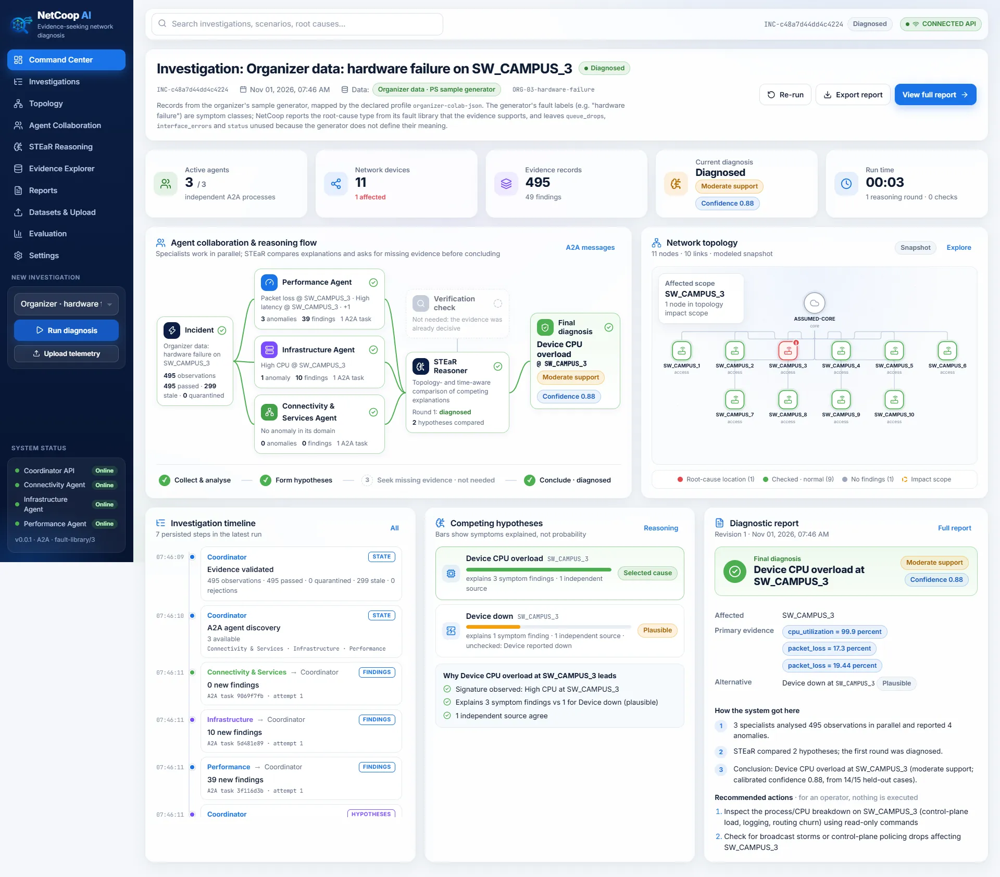 **Organizer data:** the PS sample generator's records, diagnosed with calibrated confidence |
| 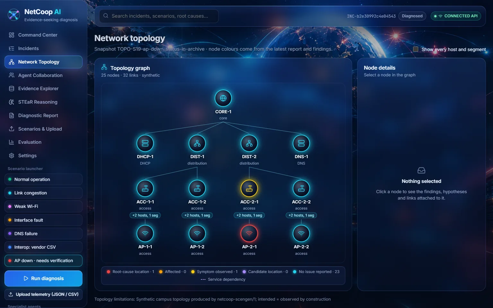 **Topology:** root cause, affected scope and node drill-down | 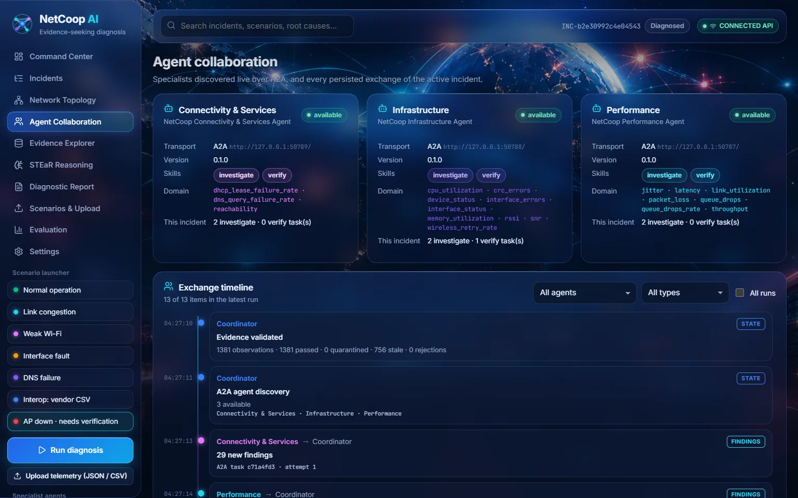 **Agent collaboration:** every A2A task and raw NDEP artifact |
| 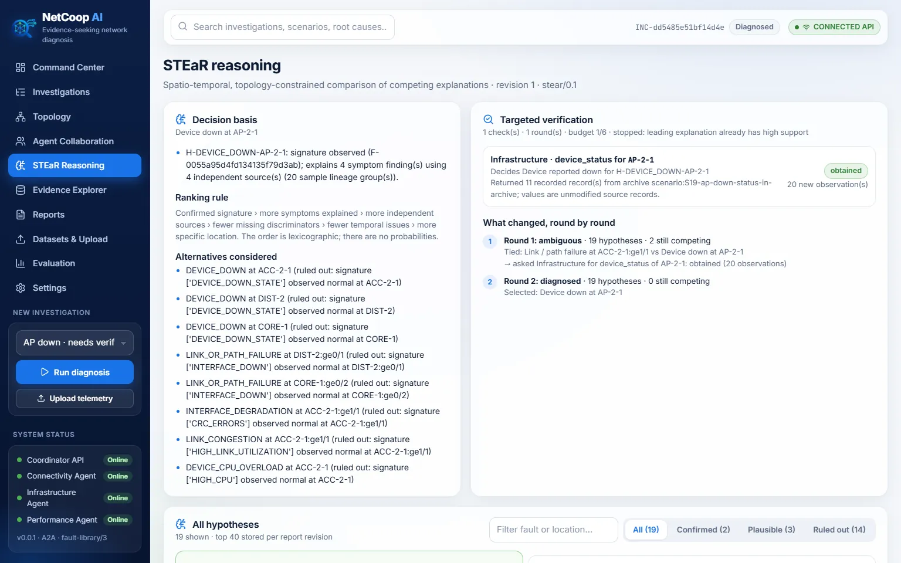 **STEaR reasoning:** decision basis, round-by-round changes, verification | 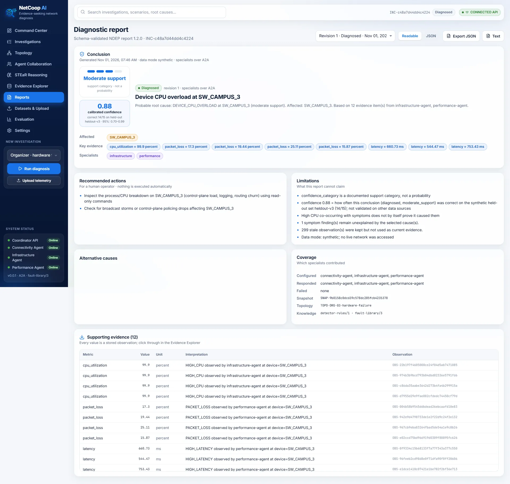 **Report:** schema-validated JSON, support category + calibrated confidence |
| 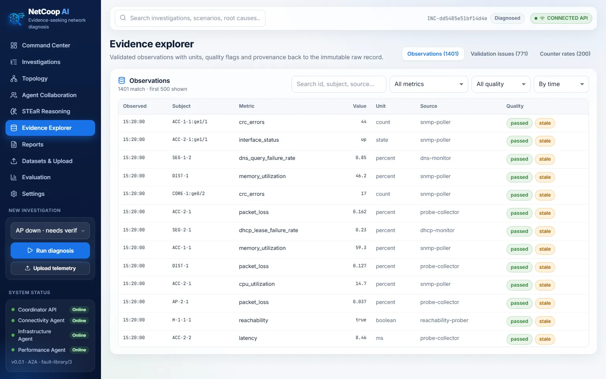 **Evidence:** units, quality flags, lineage to the immutable raw record | 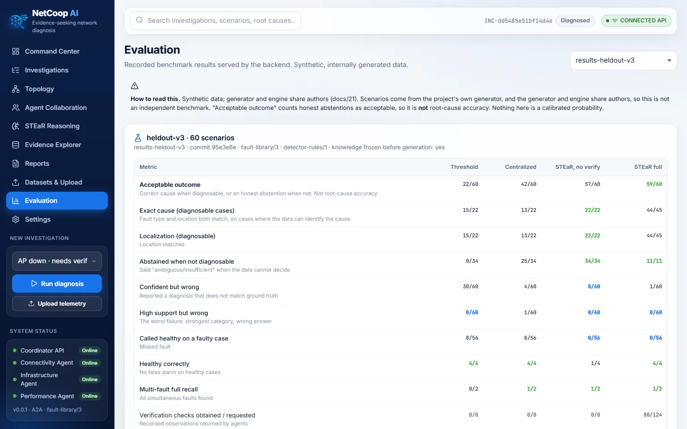 **Evaluation:** recorded benchmark with its caveats |

Every number on screen is read back from the backend; the UI labels **PREVIEW** (a recorded real run) and **Backend offline**
states explicitly. Details: [frontend/README.md](frontend/README.md).

## Architecture

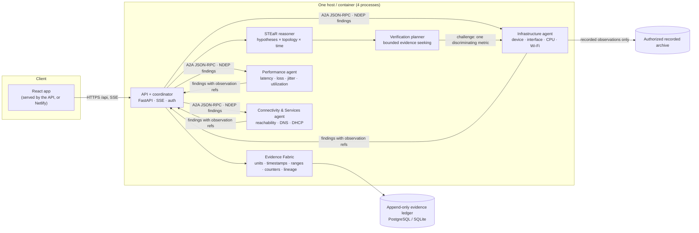

- **Agents are separate OS processes** speaking A2A (pinned SDK) with NDEP JSON artifacts; they bind to loopback only.
  Message formats, field meanings and units: [docs/24](docs/24_NDEP_A2A_PROTOCOL.md) and [spec/*.schema.json](spec/).
- **Evidence Fabric** never coerces: unknown units, ambiguous fractions, stale or impossible values are rejected or
  quarantined with typed issues; missing ≠ zero; the same counter read twice is one source.
- **STEaR** ranks explanations lexicographically (confirmed signature › symptoms explained › independent sources ›
  fewer missing discriminators › temporal consistency › specificity); it supports two concurrent faults, unknown faults
  and abstention. Details: [docs/05](docs/05_DIAGNOSTIC_ENGINE.md).

## A2A workflow (real S19 run)

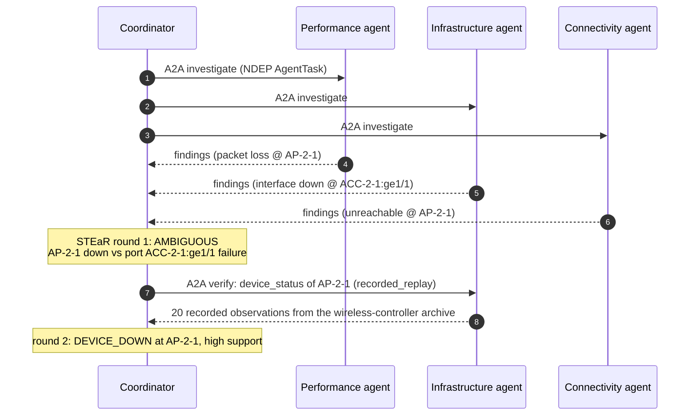

This exact exchange is asserted against the live backend by [frontend/scripts/e2e-s19.mjs](frontend/scripts/e2e-s19.mjs)
(18 checks, including that the exported report equals `GET /report`).

## Problem-statement coverage

| PS requirement | Implementation |
|---|---|
| Multiple collaborating agents (mandatory) | 3 specialist A2A processes + coordinator/STEaR + report builder; ≥2 agents contribute to every diagnosis (asserted by `run_local.py --check`) |
| Agent interoperability: formats, fields, units | NDEP JSON Schemas in `spec/`, metric registry with canonical units, A2A binding in [docs/24](docs/24_NDEP_A2A_PROTOCOL.md), declared source profiles for vendor formats |
| Orchestration & conflict resolution | Durable DB-backed coordinator, retries/timeouts, competing hypotheses, contradiction rules, bounded verification |
| Fault diagnosis with evidence | Every evidence item cites a stored observation (id, value, unit) and finding; root cause + affected devices + alternatives |
| Unified report: cause, evidence, devices, uncertainty, actions | `spec/report.schema.json` 1.2.0: the PS fields + `confidence`, `confidence_category`, `limitations`, `alternative_causes`, `recommended_actions` |
| Validation & error handling | Typed issues (`UNMAPPED_FIELD`, `TYPE_MISMATCH`, `OUT_OF_RANGE`, `STALE_OBSERVATION`, `DUPLICATE_RECORD`, …); scenarios S12, S13, ORG-04 |
| "Must not claim an exact root cause when evidence is insufficient" | Statuses `ambiguous`, `insufficient_evidence`, `unknown_fault`; S16, S20 and ORG-02 abstain by design |
| Confidence from a documented method | Calibrated on held-out data, with n and 95 % interval ([below](#report-and-calibrated-confidence)) |
| Sample inputs & test scenarios | `data/scenarios/` (organizer data + 20 labeled scenarios), held-out sets, `tests/` |
| Dashboard (optional) | React app (10 pages, live SSE) |
| Persistent workflow state (optional) | PostgreSQL/SQLite ledger, resumable runs, report revisions |
| Automated remediation (optional) | Deliberately **not** done: recommendations only, read-only by design |

## Report and calibrated confidence

The structured JSON report (`spec/report.schema.json`, schema 1.2.0) contains the PS fields: `incident_id`, `status`,
`suspected_root_cause`, `confidence`, `affected_devices`, `supporting_evidence[]` (observation id, finding id, metric,
value, unit, interpretation), `alternative_causes`, `recommended_actions`, `evidence_sources`, `limitations`; plus
`confidence_category` (rule-based support category), `confidence_basis`, `root_causes`, `hypotheses`,
`verification.challenges[]`, `coverage`, `decision_basis`, snapshot ids and `transport`. A plain-text rendering is at
`/report.txt`.

### Confidence

`confidence` is a **documented, calibrated estimate**: how often the same conclusion (status + support category)
was correct on the held-out set `heldout-v3` (60 cases, knowledge frozen before generation), estimated as
(k+1)/(n+2) and reported with n and a 95 % Wilson interval in `confidence_basis`. "Correct" means the exact
injected root cause for `diagnosed`, and an acceptable outcome (correct healthy call, or abstention where the data
cannot identify the cause) otherwise. Derived by `scripts/calibrate_confidence.py` from a replay of that set with the
current code (`eval/results-heldout-v3-replay-dfull/`, identical to the original v3 run on all 60 cases). The engine
emits no number if the knowledge files differ from those the calibration was measured with.

| Conclusion (`status` / `confidence_category`) | Correct on held-out v3 | `confidence` | 95 % Wilson |
|---|---|---|---|
| `ambiguous` / `ambiguous` | 11/11 | **0.92** | 0.74–1.00 |
| `diagnosed` / `high_support` | 30/30 | **0.97** | 0.89–1.00 |
| `diagnosed` / `moderate_support` | 14/15 | **0.88** | 0.70–0.99 |
| `healthy` / `not_applicable` | 4/4 | **0.83** | 0.51–1.00 |

Scope: synthetic scenarios from the project's own generator; not validated on real networks or other sources
(stated in every report's `limitations`). The support category stays the primary, rule-based verdict.

## Organizer data (PS section 5 sample generator)

The organizer's generator is kept verbatim in [data/organizer/ps_sample_generator.py](data/organizer/ps_sample_generator.py).
`uv run python scripts/build_organizer_scenarios.py` builds four reproducible scenarios from it (seeded, fixed clock,
device chosen by rejection sampling; values untouched): `ORG-01-normal`, `ORG-02-latency-spike` (SW_CAMPUS_7),
`ORG-03-hardware-failure` (SW_CAMPUS_3) and `ORG-04-schema-drift` (the latency case with six documented corrupted
records). The records are ingested through the declared source profile
[spec/profiles/organizer-colab-json.json](spec/profiles/organizer-colab-json.json) (nested `metrics.*` paths, units
from the field suffixes). `queue_drops`, `interface_errors` and `status` are **not** used: the generator does not
define whether the counts are totals or per-interval, and `status` is derived from the same metrics. They appear as
`UNMAPPED_FIELD` warnings on every ingestion. The generator gives no topology; an assumed star topology is supplied
and labeled as an assumption.

Results (tested in `tests/inference/test_organizer_scenarios.py`; expectations written before the first run):
normal → `healthy`; latency spike → `unknown_fault` at SW_CAMPUS_7 (symptoms persist, CPU overload ruled out, no
modeled cause fits); hardware failure → `DEVICE_CPU_OVERLOAD at SW_CAMPUS_3`, moderate support (CPU 99.9 % observed;
"hardware failure" is not a fault type in the library, and all evidence comes from one source, so no high support);
schema drift → same conclusion as the clean latency case, with 2 rejected, 2 partially rejected and 1 duplicate
record reported. The generator's labels are symptom classes, so only fault presence and the faulted device are used
as ground truth; these scenarios are not part of the accuracy sets.

## Scenarios

`data/scenarios/` holds **4 organizer-generator scenarios** (`ORG-*`, above) and **20 labeled synthetic scenarios**:
healthy, congestion, interface degradation, CPU overload, device down, weak Wi-Fi, interference, DNS, DHCP, upstream outage
needing verification, compound faults, an ambiguity that verification resolves (S11) and the same ambiguity with no extra
data (S16), malformed/stale/unknown-device input (S12), vendor CSV with ratios/Mbps/IST timestamps (S13), an unmodeled
fault (S15), a transient spike (S17), AP down with controller status (S18), only in the archive (S19), and nowhere (S20).
Regenerate with `uv run python scripts/generate_scenarios.py` and `scripts/build_organizer_scenarios.py`. Held-out sets:
`data/heldout*`.

## Evaluation (honest numbers)

Held-out set **v3**: 60 scenarios generated **after** the knowledge (detector rules, fault library) was frozen, with an
unseen seed. Same generator family and same authors as the engine, so this is **not** an independent benchmark and **not
real-world accuracy**. An *acceptable outcome* is the exact injected cause when the data can identify it, or an honest
abstention when it cannot.

| Metric (held-out v3, synthetic) | Threshold | Centralized | STEaR, no verify | **NetCoop (full)** |
|---|---|---|---|---|
| Acceptable outcome | 22/60 | 42/60 | 57/60 | **59/60** |
| Exact cause, on cases the data can identify | 15/22 | 13/22 | 22/22 | **44/45** |
| Abstained when not identifiable | 0/34 | 25/34 | 34/34 | **11/11** |
| Confident but wrong | 30/60 | 4/60 | 0/60 | **1/60** |
| High support but wrong | 0/60 | 1/60 | 0/60 | **0/60** |
| Called healthy on a faulty case | 8/56 | 8/56 | 0/56 | **0/56** |

Verification turns cases that are ambiguous from the initial upload into identifiable ones (45 vs 22 diagnosable),
which is why its denominators differ. Files: [eval/results-heldout-v3/](eval/results-heldout-v3/) (with
[PROVENANCE.md](eval/results-heldout-v3/PROVENANCE.md)); a replay on the current code matches all 60 cases
([eval/results-heldout-v3-replay-dfull/](eval/results-heldout-v3-replay-dfull/)). Method: [docs/21](docs/21_EVALUATION.md).

## Testing evidence

Executed, not claimed:

| What | How | Result |
|---|---|---|
| Unit, integration, A2A process, resilience, API tests | `uv run pytest` (Linux, Windows; PostgreSQL in CI) | green in [CI](https://github.com/RajRai77/netcoop-ai/actions) on every push |
| Four-process stack, real A2A diagnosis | `uv run python scripts/run_local.py --check` | CI (Windows) and locally |
| Docker Compose: internal-only agents/DB, restart persistence, backup → destroy volume → restore | CI `compose-smoke` | green |
| Single-container Render image: loopback-only agents, auth, React served, smoke over A2A, Linux memory | CI `render-image` | see the job log |
| Dev-set reproducibility (A vs NetCoop) | CI `evaluation` | green |
| Browser end to end, live backend: S19 verification workflow | `frontend/scripts/e2e-s19.mjs` | 18/18 ([result](frontend/docs/e2e-s19/result.json)) |
| Browser end to end: organizer data, calibrated confidence | `frontend/scripts/e2e-organizer.mjs` | 10/10 ([result](frontend/docs/e2e-organizer/result.json)) |
| Preview / offline modes, basic accessibility | `e2e-modes.mjs`, `a11y-check.mjs` | 14/14, 11/11 routes |
| Release ZIP from a clean extraction | `uv run python scripts/make_release.py --verify` | see [Deployment](#deployment) |

## Sign-in and data isolation

Hosted deployments use **Google sign-in through Clerk**: the landing page is public, "Continue with Google" leads to
the Command Center, and every API request carries a short-lived Clerk session token verified server-side with Clerk's
official Python SDK (signature, expiry, authorized party, issuer). Each investigation belongs to the signed-in
account; other accounts get 404. Local runs and CI keep explicit `none`/`token` modes. Details and the owner checklist:
[docs/27_AUTHENTICATION.md](docs/27_AUTHENTICATION.md).

## Deployment

| Option | Files | State |
|---|---|---|
| **Local, one command** | `start.sh`, `start.ps1`, `scripts/run_local.py` | verified |
| **Release ZIP** (includes the built React app) | `scripts/make_release.py --verify` | built and verified from a clean extraction; SHA-256 published with the release |
| **Docker Compose** on one Linux host (reference deployment: 5 containers, PostgreSQL, Caddy HTTPS overlay) | `compose.yaml`, `compose.production.yaml`, `Dockerfile` | verified in CI; no public VPS deployment performed |
| **Render** (one free web service, four processes in one container) + **Neon** PostgreSQL | `Dockerfile.render`, `render.yaml` | live at https://netcoop-ai-07i3.onrender.com; image verified in CI (token and Clerk modes); [docs/26](docs/26_HOSTED_DEPLOYMENT.md) |
| **Netlify** (React app only, calls the Render API) | `netlify.toml` | see [docs/26](docs/26_HOSTED_DEPLOYMENT.md) |

The Render image runs the API on `0.0.0.0:$PORT` and the three agents on `127.0.0.1` with dynamic ports; only the API is
reachable. Secrets (`NETCOOP_DATABASE_URL`, `NETCOOP_API_TOKEN`) are set in the provider dashboards, never in the
repository or in `VITE_*` frontend variables.

### Docker Compose (Linux)

```sh
cp .env.example .env      # set POSTGRES_PASSWORD, NETCOOP_AGENT_TOKEN (hex), optionally NETCOOP_API_TOKEN
docker compose up -d --build --wait
BASE_URL=http://127.0.0.1:8000 sh scripts/smoke.sh
docker compose down       # keeps data; `down -v` DELETES the database volume
```

Backup/restore: `sh scripts/backup.sh` / `sh scripts/restore.sh <file>` (Compose, pg_dump custom format; CI restores onto a fresh volume). Local SQLite: `uv run netcoop --database-url sqlite:///var/netcoop.db db backup backups/netcoop.db`.

Services: `db` (PostgreSQL 17, internal), `web`, `agent-performance`, `agent-infrastructure`, `agent-connectivity`.
The agents sit on an internal network and are reached by service DNS. Only `web` is published, on 127.0.0.1.
Production overlay: `-f compose.production.yaml` adds Caddy HTTPS, read-only containers and log limits, and requires
`NETCOOP_API_TOKEN`, `NETCOOP_DOMAIN` and `ACME_EMAIL`. This is verified in GitHub Actions (`compose-smoke`). A public
VPS deployment has **not** been performed.

## API

`GET /health/live`, `/health/ready` · `GET /api/agents` (live A2A discovery) · `GET /api/scenarios` ·
`POST /api/incidents` (`{scenario_id}` or `{data_mode, title, topology, reference_time}`) ·
`POST /api/incidents/{id}/telemetry[?profile=…]` · `POST /api/incidents/{id}/archive` ·
`POST /api/incidents/{id}/diagnose` (`{verification}`) · `GET /api/incidents/{id}` · `/report[?revision]` · `/report.txt` ·
`/timeline` (events, A2A attempts, challenges) · `/attempts/{attempt_id}` (raw artifact) · `/evidence` · `/findings` ·
`/topology` · `/stream` (Server-Sent Events) · `GET /api/raw-records/{raw_id}` · `GET /api/evaluations[/{name}]`. Interactive docs: `/docs`; exported contract [docs/openapi.json](docs/openapi.json); frontend guide [docs/25_FRONTEND_INTEGRATION.md](docs/25_FRONTEND_INTEGRATION.md). Separate frontend dev server: `uv run python scripts/run_local.py --cors-origin http://localhost:5173`. If `NETCOOP_API_TOKEN` is set, `/api/*`
needs `Authorization: Bearer …`.

CLI: `uv run netcoop --database-url sqlite:///var/netcoop.db db upgrade | incident create | ingest [--profile] | evidence`.

## Honest limitations

- Accuracy numbers come from synthetic data of one generator family (same authors as the engine). The organizer's sample
  generator is supported and tested, but its labels are symptom classes, so it cannot measure root-cause accuracy.
- `confidence` is calibrated only on synthetic held-out data with small samples (n = 4 to 30 per conclusion).
- Detector thresholds are engineering defaults; the fault library covers 9 fault types. Anything else is `unknown_fault`
  (e.g. the generator's "hardware failure" is reported as the CPU overload its data shows).
- Verification queries recorded archives (`recorded_replay`). Live read-only collectors (gNMI/SNMP) are adapter points,
  not implemented.
- Single-node deployments are not highly available. Hosted status and measured memory: [docs/26](docs/26_HOSTED_DEPLOYMENT.md).

## Repository map

| Path | Content |
|---|---|
| `src/netcoop/evidence/` | Evidence Fabric: validation, units, counters, source-profile adapters |
| `src/netcoop/agents/` | Specialist agents, detectors, A2A server |
| `src/netcoop/orchestration/` | Coordinator, A2A client ports |
| `src/netcoop/engine/` | STEaR, verification planner, report builder |
| `src/netcoop/knowledge/` | Detector rules, fault library, confidence calibration |
| `src/netcoop/api/` · `storage/` | FastAPI app, SSE · SQL ledger, migrations |
| `spec/` | NDEP JSON Schemas, metric registry, source profiles |
| `frontend/` | React app ([README](frontend/README.md)) |
| `data/` · `eval/` | Scenarios, organizer generator, held-out sets · recorded evaluation results |
| `docs/` | Requirements, architecture, ADRs, protocol, evaluation, deployment, progress |
| `tests/` | pytest suites (normalization, inference, agents, integration, resilience, API, storage) |
