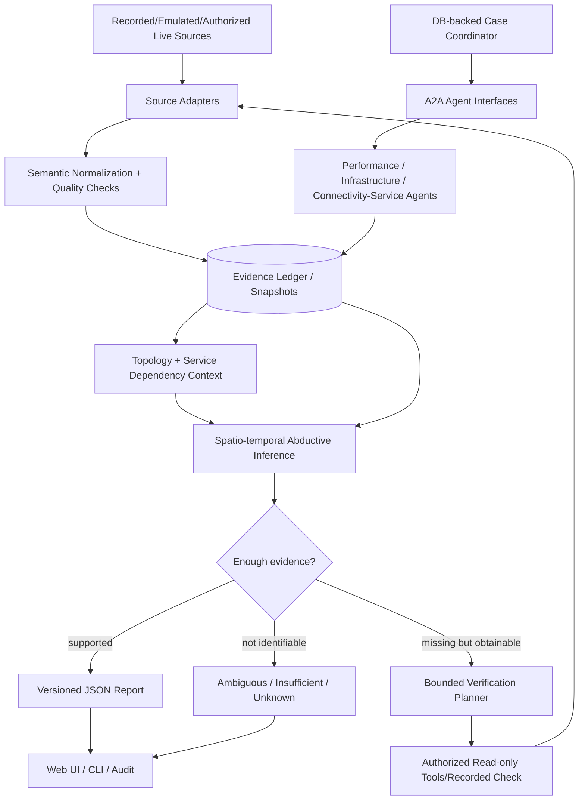
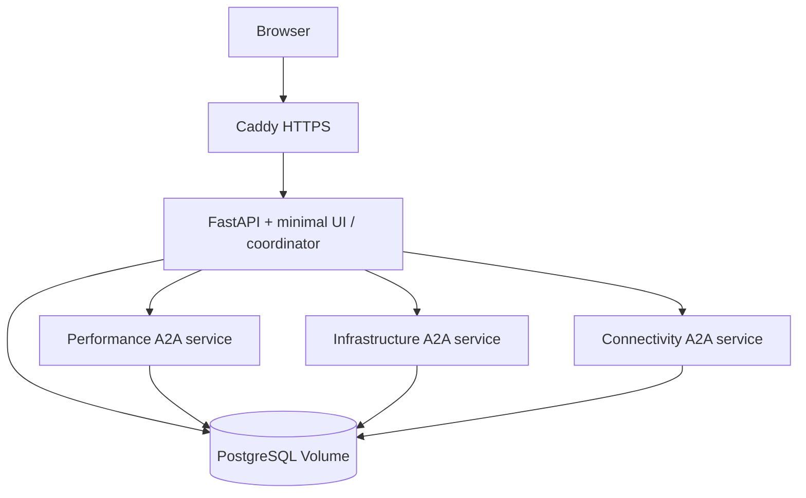

# Architecture — logical boundaries and deployment shape

## Thesis

**NetCoop AI = interoperable evidence-seeking diagnosis under uncertainty.** Specialists independently analyze validated observations. A case coordinator obtains typed findings, an auditable spatio-temporal hypothesis engine compares candidate faults, and a bounded verification planner seeks missing/discriminating *authorized* evidence. No guaranteed diagnosis when evidence is insufficient.

## Logical pipeline

## Trust and authority boundaries

- **Collection adapters** own input acquisition (OpenConfig/gNMI when supported; other adapters for file/API/SNMP etc). Do not presume telemetry endpoint availability.
- **Evidence Fabric** owns raw provenance, schema/unit validation, temporal normalization and quality flags. Invalid data must not silently pass downstream.
- **Evidence Store** owns committed observations/findings, versions, immutable history and snapshot IDs; A2A task messages do **not** substitute for durable evidence.
- **Specialist Agents** own domain-specific detection and targeted analyses, using allowed evidence. They cannot finalize an incident or modify equipment.
- **Case Coordinator** owns scheduling, timeouts, task idempotency, coverage and the stop/abstain decision policy; it does NOT make up symptoms.
- **Diagnostic Engine** owns hypothesis set evaluation, topology temporal consistency, contradictions and bounded multi-fault candidate search; deterministic without LLM.
- **Verification Planner** selects already available or explicitly authorized additional observations; no unauthorized active probes.
- **Reporting** renders a validated JSON document plus optional Markdown/browser view; narrative cannot add unsupported facts.

## Network context: three distinct kinds of truth

1. Intended state (inventory/config; NetBox optional).
2. Observed state (actual telemetry, neighbor/path data, timestamps).
3. Modeled forwarding (Batfish when valid config snapshots and support exist).

Do not collapse these into one allegedly perfect topology. Every inference references `topology_snapshot_id` and states path/dependency uncertainty. The graph may have cycles, redundant paths and failover; never assume a tree or choose a naive common ancestor in all cases.

## Three initial specialist domains

1. Performance — latency, jitter, loss, utilization, throughput and queue congestion indicators.
2. Infrastructure — device health, interface errors/flaps, resource pressure and available wireless device metrics.
3. Connectivity & Services — reachability, routing/path scope, DNS/DHCP and service dependencies.

Extra specialists via stable `AgentPort` + A2A typed contracts; avoid creating an agent for unit conversion, reporting or database storage.

## Two operational modes, one diagnostic core

- **Offline reproducible mode:** run tests and diagnosis from versioned JSON/CSV + topology files. Fully functional without LLM, live devices, Temporal or NetBox.
- **Deployed multi-agent mode:** web/API + >=2 independent A2A specialist processes, coordinator, PostgreSQL, HTTPS proxy. Evidence sources may be recorded or authorized live; mode always visible. Agents must be real independent processes in integration tests.

## Current deployable topology

**Refinement:** specialists should normally submit findings through a central evidence API/repository abstraction rather than each service owning unrestricted DB credentials. The drawing is logical; deploy with narrowly scoped services, or have only API/coordinator write to DB and agents return validated artifacts. The latter is the preferred first implementation.

## Constraints and trade-offs

- Never couple successful diagnosis to network emulator startup or external APIs.
- No Kafka, Kubernetes, vector database, large graph DB, Temporal server, or independent reporting agent by default.
- Reliability goals are measured, not implied: one-server Compose is **not** high availability, and recovery is limited by storage/backup/infrastructure.
- User facing modes and evidence provenance must remain accurate under uncertainty and partial failures.
